# 4. Kết quả & phân tích lỗi

> Nguồn số liệu duy nhất: `ocr-collab/artifacts/evidence_full_inference_all_v3/` (full inference, 100 docs, metric v2.1, `summary.json` + `metrics.csv` + `field_errors.csv` + `predictions.jsonl` + `document_success.csv`). Chuẩn benchmark theo `docs/ocr_pipeline_benchmark_metrics.md`. Thời gian present gợi ý 6–7 phút.

## 4.1. Kết quả tổng thể

| Chỉ số | Giá trị | Target | Kết luận |
|---|---|---|---|
| **Document Success@5%** | **35/100 (0.35)** | PoC ≥ 0.80, Stretch ≥ 0.90 | **Chưa đạt** — thiếu 45 văn bản nữa mới tới PoC |
| Macro primary F1 (replay v14_b2) | ~0.78 | — | Tham khảo, không thay Document Success |
| Tổng lỗi Wrong/Missing | 241 / 1300 ô field | — | Trung bình 2.4 lỗi/văn bản |

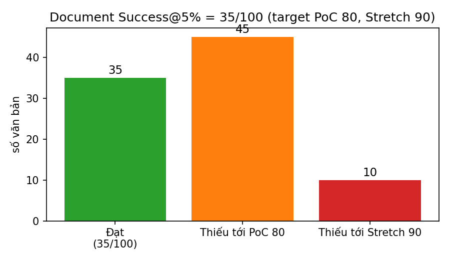

### Thời gian & tài nguyên (đúng §8: ghi cả phạm vi + nguồn đo)

| Chỉ số | Giá trị | Nguồn/phạm vi |
|---|---|---|
| Thời gian TB / văn bản | 44.0s | wall-clock pipeline, 100 docs |
| Thời gian TB / trang | 2.48s (median 2.38s, min 1.14s, max 5.85s) | 22.49 trang/văn bản TB |
| RAM TB / đỉnh | 2745 MB / 6012 MB | tiến trình benchmark |
| Device VRAM TB / đỉnh | 3077 MB / 6793 MB | toàn GPU (`nvidia-smi.memory.used`), mọi tiến trình |
| Process VRAM | `null` | chỉ nhận NVML/nvidia-smi per-PID (`NSpid`-aware); WSL `[N/A]` bỏ qua, không quy về 0 |
| Framework allocator | torch TB 121 MB / đỉnh 3446 MB; paddle TB 36 MB / đỉnh 117 MB | `torch.cuda.memory_allocated` + `paddle.device.cuda.memory_allocated`, chẩn đoán bổ sung, không thay process VRAM |
| GPU | Quadro RTX 5000 | `manifest.json` |

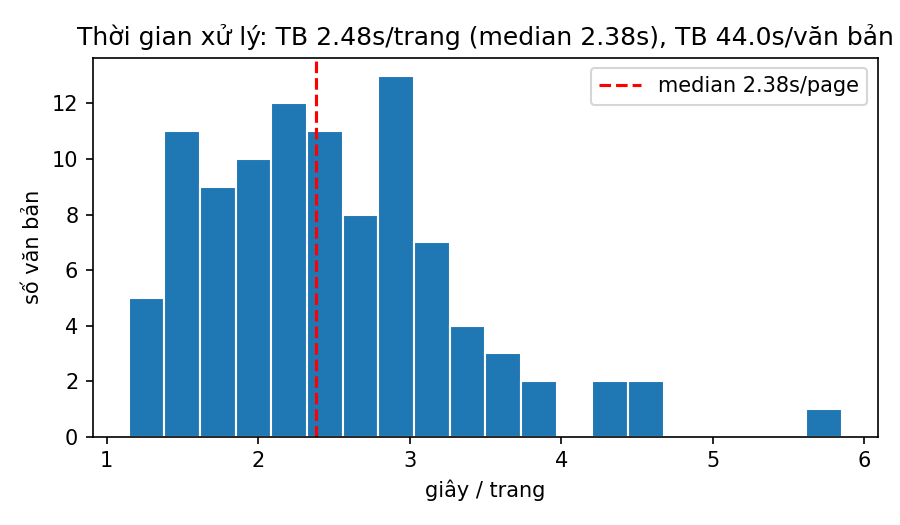

## 4.2. Kết quả theo field

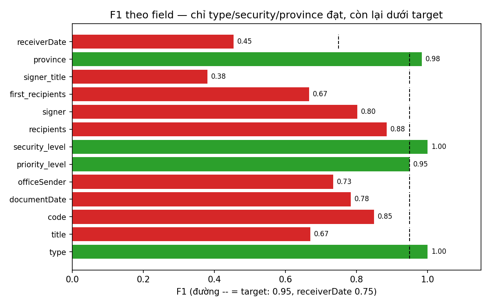

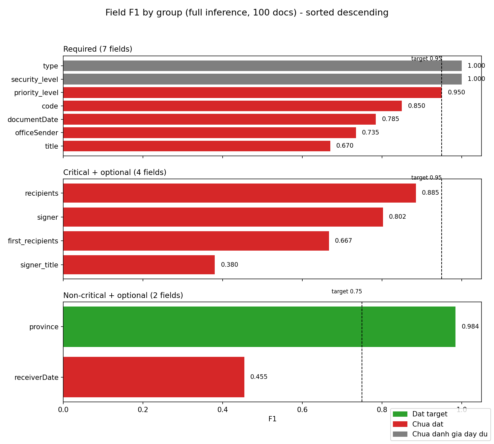

### Required — Critical + required (target F1 ≥ 0.95)

| Field | F1 / NEM / P / R | Trạng thái |
|---|---|---|
| type | 1.00 / 1.00 | Tốt nhưng `Chưa đánh giá đầy đủ` (không có mẫu GT trống để tính hallucination) |
| security_level | 1.00 / 1.00 | Như trên; chưa có mẫu `1_MẬT/2_TỐI MẬT/3_TUYỆT MẬT` |
| priority_level | 0.95 / 0.95 | Sát target, rớt precision; thiếu lớp `2_KHẨN/3_THƯỢNG KHẨN` |
| code | 0.85 / 0.85 | 15 Wrong |
| documentDate | 0.785 / 0.71 | 10 Wrong + 19 Missing |
| officeSender | 0.735 / 0.67 | 24 Wrong + 4 Missing |
| title | 0.67 / 0.40 | 31 Wrong + 3 Missing |

### Critical + optional (target F1 ≥ 0.95)

| Field | F1 / NEM / P / R | Trạng thái |
|---|---|---|
| recipients | 0.885 / 0.341 | NEM thấp: nhiều Acceptable (CER ≤ 5%) nhưng ít Exact |
| signer | 0.802 / 0.745 | 11 Wrong + 14 Missing |
| first_recipients | 0.667 / 0.50 | 4 Wrong + 9 Missing (GT present chỉ 30/100) |
| signer_title | 0.38 / 0.296 | **Bottleneck số 1**: 51 Wrong + 12 Missing |

### Non-critical + optional (target F1 ≥ 0.75)

| Field | F1 / NEM / P / R | Trạng thái |
|---|---|---|
| province | 0.984 / 0.979 | **Đạt** — field duy nhất đạt |
| receiverDate | 0.455 / 0.294 | Precision 1.0 nhưng recall 0.29 (12/17 GT có giá trị bị Missing) |

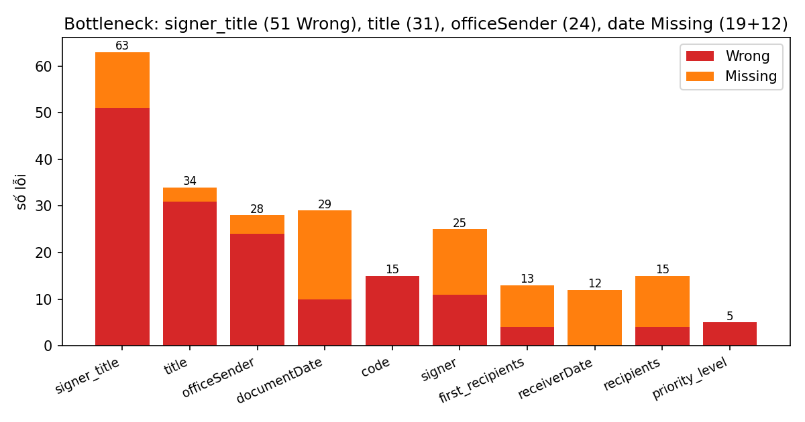

**Bottleneck chính (theo số lỗi):** `signer_title` (63) > `title` (34) > `officeSender` (28) > `documentDate` (29) > `signer` (25) > `code` (15) > `first_recipients`/`receiverDate` (13/12 Missing). Required fail nhiều nhất làm rớt Document Success: `title`, `documentDate`, `officeSender`, `code` (xem `document_success.csv`, ví dụ `02+NQ-KM` fail 3 required, `03+BC_2020` fail 3 required).

## 4.3. Phân tích lỗi (taxonomy §9)

### a) OCR / chính tả (kể cả chữ viết tay ở code/date)

Ví dụ `8931+VPCP-PL_2026-08-29` — ngày và cơ quan đều sai 1 ký tự do OCR:

* `documentDate`: GT `29/08/2026` → pred `19/08/2026` (`Wrong`). Evidence `issuance-date`: `source_text="Hà Nội, ngày 19 tháng 8 năm 2026"`.

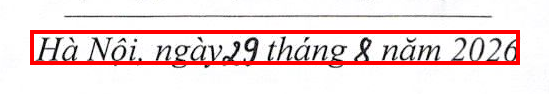

* `officeSender`: GT `VĂN PHÒNG CHÍNH PHỦ` → pred `VĂN PHÒNG CHÍNH PHỦNH PHỦ` (dính chữ). Evidence `upper-left-organization`: `source_text="VĂN PHÒNG CHÍNH PHỦNH PHỦ"`.

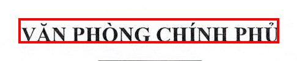

Cùng họ: `code 118→418`, `131→31`, `1671→1071`, `date 27/12→27/01`, `officeSender BỘ TÀI CHÍNH→BỌ TÀI CHÍNH`, `title xử phạt→xử phạm`.

### b) Layout / crop trộn nội dung

`title` hay bị lẫn header/footer vào trích yếu: `12+NQ-PVIRe` pred lẫn `SỞ GIAO DỊCH CHỨNG KHOÁN HÀ NỘI ... HỘI ĐỒNG QUẢN TR...` (CER 0.81); `1205+QĐ-UBCK` lẫn `sở giao dịch chứng kyề... STP.HỒ CHÍ MINH số 4203.9` (CER 0.73). `officeSender 240+TB-PVIRe` pred=`"Số:"` (bắt nhầm anchor). `signer_title` nhiều case hút rác tổ chức vào chức danh (ví dụ `131+QĐ-SGDHCM` CER 1.66).

### c) Dấu mộc / chữ ký / con dấu

Case `29+CT-TTg_2026-07-16` (Chỉ thị scan 4 trang, header Exact hết, lỗi dồn ở cụm dấu/ký):

* `priority_level`: GT `1_HỎA TỐC` → pred `0_BÌNH THƯỜNG`, evidence rỗng — dấu Hỏa tốc đỏ không đọc được (xem trang 1, cụm ô 10b).
* `signer`: GT `Hồ Quốc Dũng` → pred `Huốc Dũng` (mất chữ, nghi dấu/chữ ký đè). Evidence `signature-name` trang 4: `source_text="Huốc Dũng"`.
* `signer_title`: GT `KT. THỦ TƯỚNG PHÓ THỦ TƯỚNG` → pred Missing.

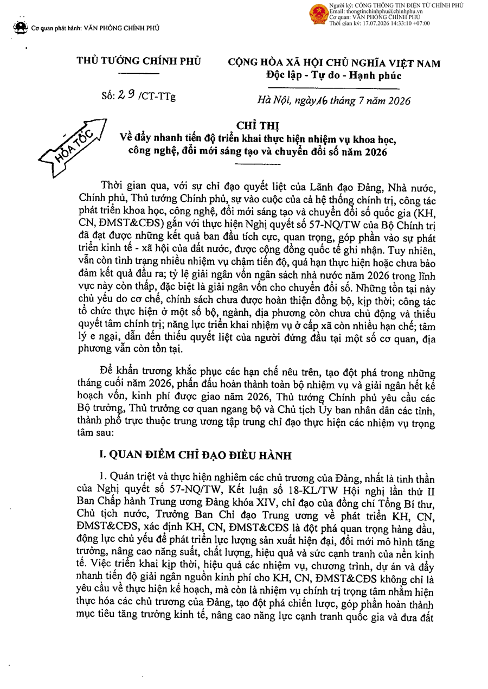

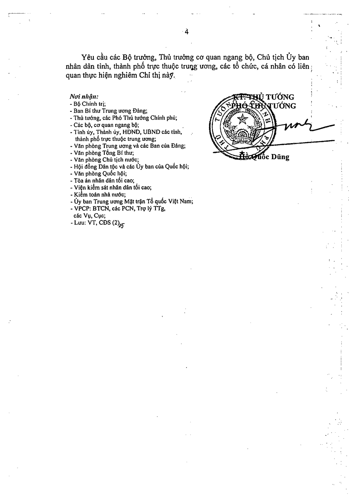

Cùng mẫu 5 file `priority_level Wrong` (`27+CT-TTg`, `32+CĐ-UBND`, `5963+BCT-TTTN`, `8931+VPCP-PL`) đều GT Hỏa tốc mà evidence rỗng — xem thêm mục GT issue.

### d) Extraction / Heuristics

* `first_recipients 2125+TB-ĐLTKV`: GT đã bỏ stub số thứ tự, pred giữ lại `...; số 1.772; ...`. Nguồn `Kính gửi: - Uỷ...; số 1.772 - Sở...` — pipeline cần lọc stub số như đã làm với stamp-stub.

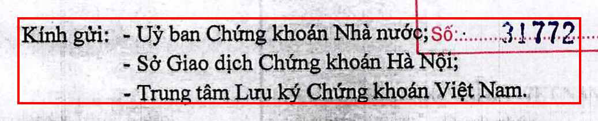

* `signer_title 1321+QĐ-UBND`: GT `KT. CHỦ TỊCH PHÓ CHỦ TỊCH` (nối space) vs pred `KT.CHỦ TỊCH; PHÓ CHỦ TỊCH` (tách `;`). Evidence 2 block riêng `KT.CHỦ TỊCH` + `PHÓ CHỦ TỊCH` — pred đúng §3.1 (nhiều chức danh độc lập phân cách `; `), xem thêm mục GT.

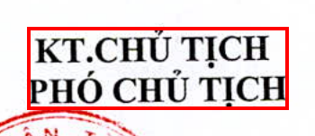

### e) Missing / hallucination

* `documentDate Missing` 19 docs (ví dụ `03+BC_2020`, `1321`, `15+MED+2020`): pipeline trả `""` theo §3.4 (fallback `thông qua ngày...` đang tạm bỏ). Không hallucinate ngày.
* `receiverDate Missing` 12/17 GT có giá trị (ví dụ `03+BC.HĐQT 24/02/2020→""`): precision 1.0, recall 0.29 — chỉ lấy từ dấu đến, dấu mờ là mất. Hallucination = 0 (tốt).
* `first_recipients Missing` 9 docs nhóm VPCP/BCT (`8871/8906/8907/8916/8948/5509...`): GT dài, pred `""`, evidence rỗng. Ví dụ `8948` trang 1 bên dưới — cần check Kính gửi có nằm ngoài trang 1 hay layout miss.

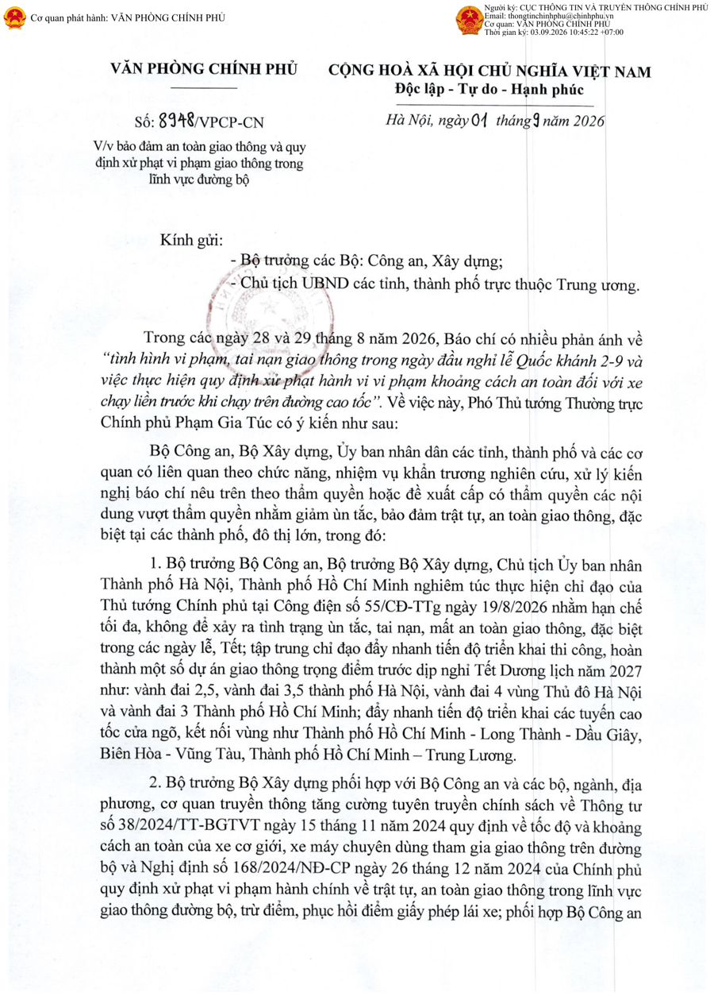

* Hallucination toàn bundle = 0 ở mọi field có mẫu GT trống (recipients/first_recipients/signer/signer_title/province/receiverDate) — điểm tốt.

### f) Nghi vấn GT (đã đối chiếu trace, không sửa GT trên đĩa)

1. `code 03+BC.HĐQT`: GT `03/BC.HĐQT` vs pred `03/BC-HĐQT`. Trace `source_text="Số 03/BC HĐQT"` (space, không chấm). Theo §3.2 space → `-`, xóa `.` → pred đúng, GT giữ `.` sai rule.

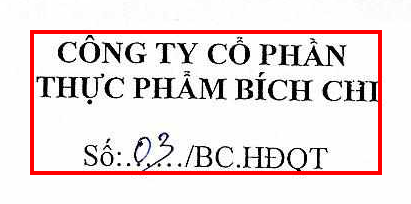

2. `code 27+2026+VBHN-ND-BTC`: GT `...-ND-BTC` vs pred `...-NĐ-BTC`. Trace `source_text="Số 27/2026/VBHN-NĐ-BTC"` — GT thiếu dấu `Đ`.
3. `signer_title` họ `KT. ...` (`1321/1679/1685/...`): GT nối 2 chức danh bằng space, pipeline tách `; ` đúng §3.1. Loạt fail này là lệch policy GT–spec, không phải extraction sai nội dung.
4. `priority_level` 5 file Hỏa tốc mà evidence rỗng: hoặc OCR miss dấu đỏ, hoặc GT gán nhãn khi PDF không có dấu — cần review ảnh màu trang 1 trước khi sửa rule.
5. `UỶ vs ỦY` (`1321`): khác điểm mã Unicode, `NFKC+casefold` vẫn `Wrong` — thuộc chuẩn hóa benchmark/GT, không phải lỗi đọc.

## 4.4. Ví dụ lỗi tiêu biểu (đọc trong 60 giây)

| # | File | Field | GT → Pred (bucket) | Nguyên nhân chính |
|---|---|---|---|---|
| 1 | `8931+VPCP-PL` | documentDate | `29/08/2026`→`19/08/2026` (Wrong) | OCR 1 ký tự |
| 2 | `29+CT-TTg` | signer/priority/signer_title | `Hồ Quốc Dũng`→`Huốc Dũng`; `HỎA TỐC`→`BÌNH THƯỜNG`; mất chức danh | Dấu mộc/chữ ký đè |
| 3 | `8948+VPCP-CN` | documentDate/first/signer_title | Mất ngày + Kính gửi; chức danh lẫn rác `TO Es CHI...` | Scan + OCR vùng ký/dấu |
| 4 | `2125+TB-ĐLTKV` | first_recipients | thừa stub `số 1.772` | Extraction chưa lọc stub |
| 5 | `1321+QĐ-UBND` | signer_title | `KT. CHỦ TỊCH PHÓ...` → `KT.CHỦ TỊCH; PHÓ...` | GT nối space vs spec `; ` |
| 6 | `03+BC.HĐQT` / `27+VBHN` | code | `.` vs `-`; `ND` vs `NĐ` | Nghi vấn GT (trace ủng hộ pred) |

## 4.5. Chốt cho sếp (1 slide)

* Con số: **35/100**, còn cách PoC **45 văn bản**. Field duy nhất đạt là `province`; `type/security` đúng 100% nhưng thiếu mẫu phủ hallucination/lớp enum.
* Bệnh lớn nhất: **vùng ký/chức danh** (`signer_title` F1 0.38) + **trích yếu dài** (`title` F1 0.67) + **ngày** (19 Missing) — đều tập trung ở scan/dấu mộc/chữ viết tay.
* Điểm tốt: **không hallucinate** (precision receiverDate 1.0, các field optional hallucination 0), `code`/`officeSender` khung QH-anchored đã ổn ở bản in đẹp.
* Việc tiếp theo: tiền xử lý scan + OCR vùng dấu/ký; lọc stub `first_recipients`; chốt policy GT (`;` signer_title, stub số, `Quyết định` trong title, fallback ngày) rồi mới rescore — tuyệt đối không so `summary.json` khác snapshot GT (§6).
